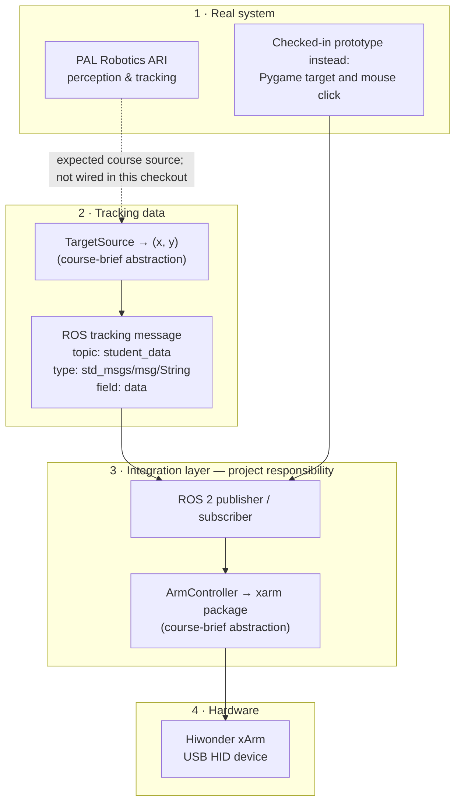
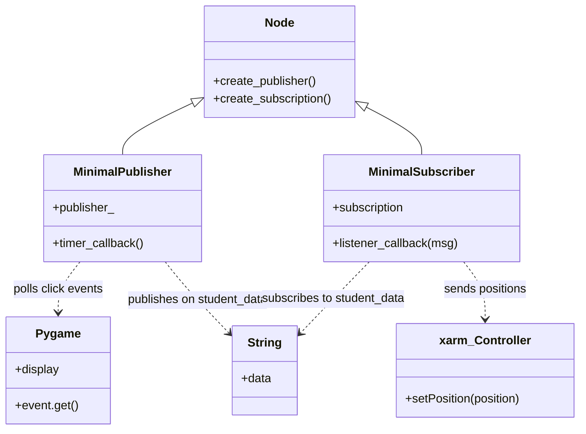
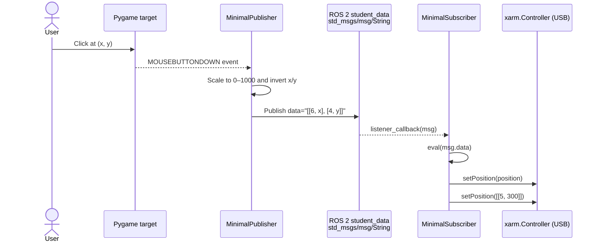

# Architecture write-up

## System overview

The course architecture separates perception, tracking data, integration, and
hardware. This checkout is a prototype: it gets coordinates from Pygame mouse
clicks, not PAL Robotics ARI. The distinction matters when assessing evidence
or extending the system.

At the system boundary, ARI is expected to perceive and track people; tracking
data should carry a selected `(x, y)` target; ROS 2 transports that target
between processes; and an xArm HID device executes motion through the `xarm`
Python package. The current code begins at a simulated click and ends with a
controller call. The central integration responsibilities—source abstraction,
message contract, safe conversion, and controller boundary—are therefore only
partly represented.

`MinimalPublisher` scales and inverts click coordinates to 0–1000, then
publishes a Python-literal string such as `[[6, 750], [4, 750]]` on
`student_data` as `std_msgs/msg/String` (`data`). `MinimalSubscriber` parses
that value and calls the xArm, followed by `[[5, 300]]`. This is not a typed
tracking message; compare it with the Part C log before treating it as stable.

## Polymorphism and mocking

The requested `TargetSource` seam for substituting mock and ARI-backed sources
is absent: the publisher reads Pygame events directly. The diagram's
`TargetSource` is a course-design abstraction, not a checked-in class. Tests
inject fake Pygame events and verify output coordinates; they neither simulate
ARI internals nor demonstrate source interchangeability.

The design reason to keep such sources interchangeable is to preserve one
downstream consumer while replacing only the producer: the mock would provide
repeatable click targets, while an ARI adapter would translate actual tracking
messages into the same validated coordinate contract. The mock should reproduce
that contract rather than ARI internals, so downstream tests do not depend on
robotics middleware details. This is a recommended design, not implemented
polymorphism or swap-test evidence in this repository.

The current class relationships are:

## Hardware interface and evidence

The subscriber creates `xarm.Controller('USB')` at module import and calls
`setPosition()`. This documents the intended HID path, not proof of device
connection, channel mapping, or the safety of channel 5 at 300. Part A notes
were not supplied, so physical movement and these assumptions remain
unverified pending a controlled test and recorded evidence.

The current execution environment's `lsusb` output did not identify an xArm;
that observation is limited to this VM and does not establish the project's
bench setup. No controller-board model, `xarm` package version, firmware
version, or HID vendor/product ID is recorded here. Those belong in Part A
alongside the dated environment observations and the `xarm.Controller` API
reading notes.

The subscriber also uses `eval(msg.data)`. Only trusted messages should reach
it; production use needs safe parsing and validation of payload shape, channels,
and bounds. Test in a restricted workspace with an emergency stop available.

## Runtime boundaries

The nodes communicate only through ROS. Click coordinates are divided by
window width/height minus one, rounded, then inverted; tests cover two corners
and one interior point. The publisher's local colour-based score is not
published and does not affect motion. Its timer callback contains a `while`
loop that polls Pygame until quit, so the one-second timer is not a message
cadence and occupies the executor. Echo `/student_data` before enabling the
arm; move UI polling out of the callback and add explicit shutdown handling.

## Testing and click-to-arm flow

[`python/test.py`](python/test.py) fakes Pygame and ROS, then checks three
published strings without a display or arm. It verifies coordinate conversion
and publisher output, not subscriber parsing or movement. The fixture does not
construct a fake `xarm.Controller`; the subscriber creates its controller at
module import. No injected `ArmController`, subscriber test, or source-swap
test is present. A next step is constructor-injected source/controller
contracts, enabling a mocked-message test to assert both requested positions
without USB hardware. These are recommendations, not existing evidence.

The repository's test demonstrates a small zero-hardware boundary, not a
full-chain CI guarantee: ROS message delivery and the controller are not
exercised together. The final message contract visible in code is the relative
topic `student_data`, type `std_msgs/msg/String`, field `data`, with no frame,
timestamp, or rate metadata. The assignment's provisional tracking-message
contract must be reconciled against the Part C investigation log; that log is
not present, so no claimed ARI topic, frame, or update rate is supplied here.

## Known limitations and next steps

- **Coordinate calibration is approximate.** Tests confirm mapping for three synthetic clicks, not physical accuracy. No arm calibration/repeatability measurement is recorded. Measure error at known workspace points over repeated trials and validate a mapping before accuracy matters.
- **No closed-loop control.** The subscriber neither reads feedback nor corrects error; support for read-back in the installed `xarm` package is unverified. Confirm the device API and limits, then add bounded feedback, timeouts, and fake-controller tests before hardware trials.
- **Single target only.** A click selects one point; no people are detected or identified. An ARI source reporting multiple people would have no selection or lost-target policy. Define those semantics before connecting detections to motion.
- **HID commands are fire-and-forget.** The app does not confirm completion, retry, or handle disconnects. An unplug, lost report, driver error, or stalled motion may leave the target unachieved; exact driver behavior is unverified. Add status/read-back, timeout/disconnect handling, and a safe-stop policy, then test with a fake and controlled hardware.

## Component evaluation

See the Part A component evaluation for selection rationale and dependency
versions/licences. It was not included in this workspace.
