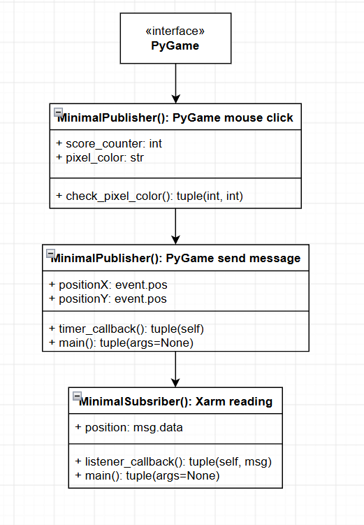

# <publish_subsriber_xarm_target>

One-paragraph pitch: what it does, for whom.
This package has a publisher and subscriber code that sends sigals using WSL/Lunix to a Xarm robot. The publisher has a pygame installed, when clicking a certain part of the screen it tracks points based on where you clicked on a archery target based on the colour clicked. The position is also recorder to then send a message to the subsriber that coverts the message into a motor movement for the robot then read to move to the position clicked. 

## Overview
UML class diagram


## Coordinate and message format

The Pygame window is 800 by 600 pixels. A click is converted as follows:

```text
xArm X = round(clicked_x * 1000 / 799)
xArm Y = round(clicked_y * 1000 / 599)
```

The resulting ROS 2 message is a string rather than a JSON or custom-message payload:

```text
[[6, xArm_X], [4, xArm_Y]]
```

Channel `6` receives the horizontal coordinate and channel `4` receives the vertical coordinate. The subscriber parses this value and calls `xArm.Controller.setPosition()`.

## Safety

- Test with the xArm disconnected or in a restricted workspace first.
- Start with safe, low-motion limits and keep an emergency stop nearby.
- Verify incoming topic values before hardware movement.
- The subscriber's `eval(msg.data)` should be replaced with `ast.literal_eval(msg.data)` and validated against an allowed channel/position range before production use.
- The subscriber sends an additional `[[5, 300]]` position after each received target position; this may cause unexpected movement and should be tuned or removed for a specific arm setup.

## Prerequisites

- A 64-bit Ubuntu virtual machine with **ROS 2 Jazzy** installed
- Python 3 with `pip`, `colcon`, `setuptools`, Pygame, and HID support
- An xArm HID device connected to the computer
- A package layout containing the publisher and subscriber Python modules

Install the Python dependencies:

```bash
sudo apt update
sudo apt install python3-colcon-common-extensions python3-pip python3-setuptools
python3 -m pip install pygame xarm hidapi
```

### WSL2 USB setup

Attach the xArm HID device to WSL using Windows `usbipd-win`:

```powershell
usbipd list
usbipd bind --busid <BUS_ID>
usbipd attach --wsl --busid <BUS_ID>
```

Then verify that Linux sees the device:

```bash
lsusb
```

For native Linux, a udev rule may be required so the user can access the device without elevated privileges.

## Installation

From the workspace containing this repository:

```bash
source /opt/ros/jazzy/setup.bash
python3 -m pip install -e .
colcon build --packages-select student_publisher
source install/setup.bash
```

The package is named `student_publisher`. The setup entry points are:

- `student_publisher` — starts the Pygame target publisher
- `student_subscriber` — starts the xArm subscriber

Before building, ensure the ROS package directories and `package.xml` match the package name and that both executable modules are importable by their configured entry points.

## Running

Run both nodes from terminals that have sourced ROS 2 and the workspace:

```bash
source /opt/ros/jazzy/setup.bash
source install/setup.bash
```

Terminal 1 — start the Pygame publisher:

```bash
ros2 run student_publisher student_publisher
```

Terminal 2 — start the xArm subscriber:

```bash
ros2 run student_publisher student_subscriber
```

Terminal 3 — inspect the nodes and target messages:

```bash
ros2 node list
ros2 topic list
ros2 topic echo /student_data
```

Click a coloured area of the Pygame target. The publisher converts the click to an xArm string position such as `[[6, x], [4, y]]` and publishes it on `/student_data`. The subscriber parses the message and requests positions from the xArm controller.

## Testing

Run the available tests with:

```bash
pytest -v
```

No xArm hardware is required for Pygame or message-format tests. Mock the `xarm.Controller` object and patch Pygame where appropriate. Hardware testing can also be performed safely by echoing `/student_data` first and checking the generated coordinates before enabling `arm.setPosition()` calls.

## Demo

Add a 20–30 second demonstration video here:

- **Demo video:** `[Add YouTube or repository video link]`

The demo should show the Pygame target, a mouse click, the `/student_data` message, and the xArm movement response.

## Licence
MIT License

Copyright (c) [2026] [Isabella Hess]

Permission is hereby granted, free of charge, to any person obtaining a copy
of this software and associated documentation files (the "Software"), to deal
in the Software without restriction, including without limitation the rights
to use, copy, modify, merge, publish, distribute, sublicense, and/or sell
copies of the Software, and to permit persons to whom the Software is
furnished to do so, subject to the following conditions:

The above copyright notice and this permission notice shall be included in all
copies or substantial portions of the Software.

THE SOFTWARE IS PROVIDED "AS IS", WITHOUT WARRANTY OF ANY KIND, EXPRESS OR
IMPLIED, INCLUDING BUT NOT LIMITED TO THE WARRANTIES OF MERCHANTABILITY,
FITNESS FOR A PARTICULAR PURPOSE AND NONINFRINGEMENT. IN NO EVENT SHALL THE
AUTHORS OR COPYRIGHT HOLDERS BE LIABLE FOR ANY CLAIM, DAMAGES OR OTHER
LIABILITY, WHETHER IN AN ACTION OF CONTRACT, TORT OR OTHERWISE, ARISING FROM,
OUT OF OR IN CONNECTION WITH THE SOFTWARE OR THE USE OR OTHER DEALINGS IN THE
SOFTWARE.